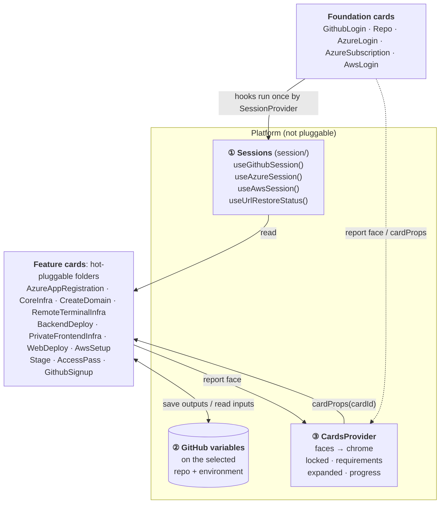
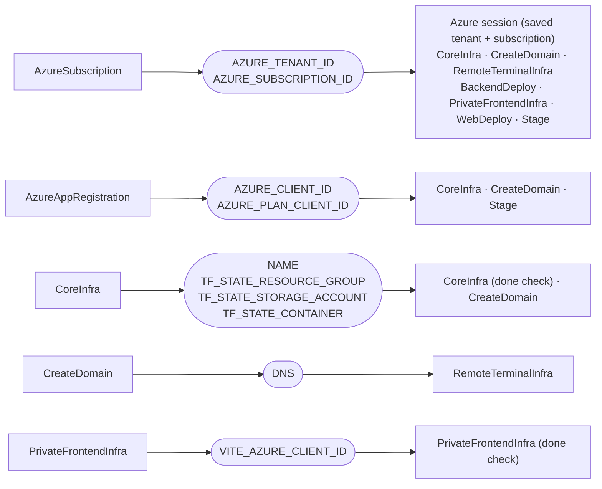
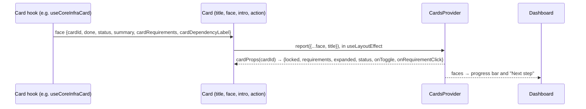

# Corp installer card architecture

How the cards in `corp-src/` are wired together. In short, each card is a self-contained folder, and cards talk to each other only through three channels that the platform owns.

## 1. Overview



| Channel | What it carries | Read with | Owned by |
|---|---|---|---|
| ① Sessions | Who is signed in, and which repo, environment, tenant and subscription are selected | `useGithubSession()`, `useAzureSession()`, `useAwsSession()`, `useUrlRestoreStatus()` | [session/SessionProvider.tsx](corp-src/session/SessionProvider.tsx) |
| ② GitHub variables | One card's saved output that is another card's input | `useGithubSession().variables` (`values`, `onConfirmed`) | [hooks/useGithubVariables.ts](corp-src/hooks/useGithubVariables.ts) |
| ③ Faces | Each card's `done`, `status`, `summary`, `cardRequirements` and title, which become every card's chrome | `useCards()` | [components/CardsProvider.tsx](corp-src/components/CardsProvider.tsx) |

No card imports another card folder, and no card takes props from App. ESLint enforces the first rule.

## 2. Provider nesting

```text
AppDashboard
└─ SessionProvider
   └─ GithubSessionProvider      useGithubLoginCard · useRepoCard · useGithubVariables
      └─ AzureSessionProvider    useAzureLoginCard · useAzureSubscriptionCard
         └─ AwsSessionProvider   useAwsLoginCard
            └─ UrlRestoreProvider useUrlRestore · useUrlSync
               └─ CardsProvider   faces · expanded card ids
                  └─ Dashboard    every cards/*/index.ts, by order
```

Each provider can read the ones above it. For example, the Azure session reads the saved `AZURE_TENANT_ID` and `AZURE_SUBSCRIPTION_ID` from the GitHub session's variables.

## 3. Channel ①: sessions

Foundation cards hold state that most other cards cannot do without (sign-ins, repo, environment, subscription). `SessionProvider` runs their hooks once for the whole page, and their card components only render what the session already holds.

| Session | Fields | Built from |
|---|---|---|
| GitHub | `login`, `repoEnv`, `variables`, `account`, `repoName`, `repoId`, `repoFullName`, `selectedEnv`, `githubUrl` | GithubLogin, Repo |
| Azure | `login`, `subscription`, `account`, `subscriptionId` | AzureLogin, AzureSubscription |
| AWS | `login` | AwsLogin |
| URL restore | `restoring`, `warnings`, `completed`, `cancel`, `dismissWarnings` | GitHub and Azure sessions |

Because `session/` imports these five folders, foundation cards cannot be unplugged. Every other card can.

## 4. Channel ②: GitHub variables

Variables live on the selected repo's GitHub environment, so they arrive with the GitHub session. A card saves its output through `CloudVariableDetail`, which calls `variables.onConfirmed(key, value)`, and any later card reads it from `variables.values`.



A variable is a contract between cards. Removing the card that writes it does not break the build. The reading card just shows the variable as missing until someone sets it by hand on GitHub.

## 5. Channel ③: faces

A card's hook returns a `CardHook` (its face). The card passes it to `<Card>`, which reports it to `CardsProvider` and gets its chrome back.



`cardProps(id)` is the only place where faces become chrome.

1. `requirements` are the card's `cardRequirements` whose face is not `done`. Each one is labelled with that face's `cardDependencyLabel`.
2. `locked` means at least one requirement is unmet. An `unavailable` (misconfigured) card shows no requirements.
3. A locked card's status is forced to `idle`, and its children are not rendered.
4. Progress and "Next step" list faces in the order they first reported, which is their order on the page. A face with `hideFromProgress` (GithubSignup) is left out.
5. `openCard(id)` adds the card to the expanded set and scrolls to `#card-<id>`.

Reports run in a layout effect, so a dependent card never flashes unlocked before the first paint. A report that changes nothing keeps the same state object, so nothing re-renders.

## 6. A card folder

```text
cards/CoreInfra/
├─ index.ts              export default { order: 70, Component: CoreInfraCard } satisfies CardModule
├─ CoreInfraCard.tsx     reads sessions, calls its hook, renders <Card face title intro action>
├─ useCoreInfraCard.ts   returns the face; declares its CardId
└─ useCoreInfraCard.test.ts
```

The hook file registers the card's id by declaration merging, so `types.ts` only collects ids:

```ts
declare module "../../types" {
  interface CardIdRegistry {
    core_infra: true;
  }
}
```

The card component declares its title (required), intro and action. Its body holds only the card's content:

```tsx
<Card title="Terraform state backend" face={coreInfra} intro={<Intro />} action={<Action />}>
  …content…
</Card>
```

### Adding a card

1. Create `cards/<Name>/` with a hook that returns a `CardHook` and declares its id in `CardIdRegistry`.
2. Add a component that reads the sessions it needs and renders `<Card face title>`.
3. Add `index.ts` exporting `{ order, Component }`. App picks it up through `import.meta.glob`, so App needs no change.

### Removing a card

Delete its folder. Its id leaves `CardId`, so any other card that still lists it in `cardRequirements` becomes a TypeScript error rather than a silent lock. Cards that read its GitHub variables show them as missing.

### Rules

| Rule | Enforced by |
|---|---|
| A card folder never imports a sibling card folder | ESLint `no-restricted-imports` on `corp-src/cards/*/**` |
| A card requires only ids that exist | TypeScript (`CardId = keyof CardIdRegistry`) |
| A card's tests live in its folder | `vitest.config.ts` includes `*-src/**/*.test.*` |
| Contexts and hooks live in `.ts` files, providers and components in `.tsx` files | ESLint `react-refresh/only-export-components` |
| Foundation cards (GithubLogin, Repo, AzureLogin, AzureSubscription, AwsLogin) stay | `session/` imports them |
