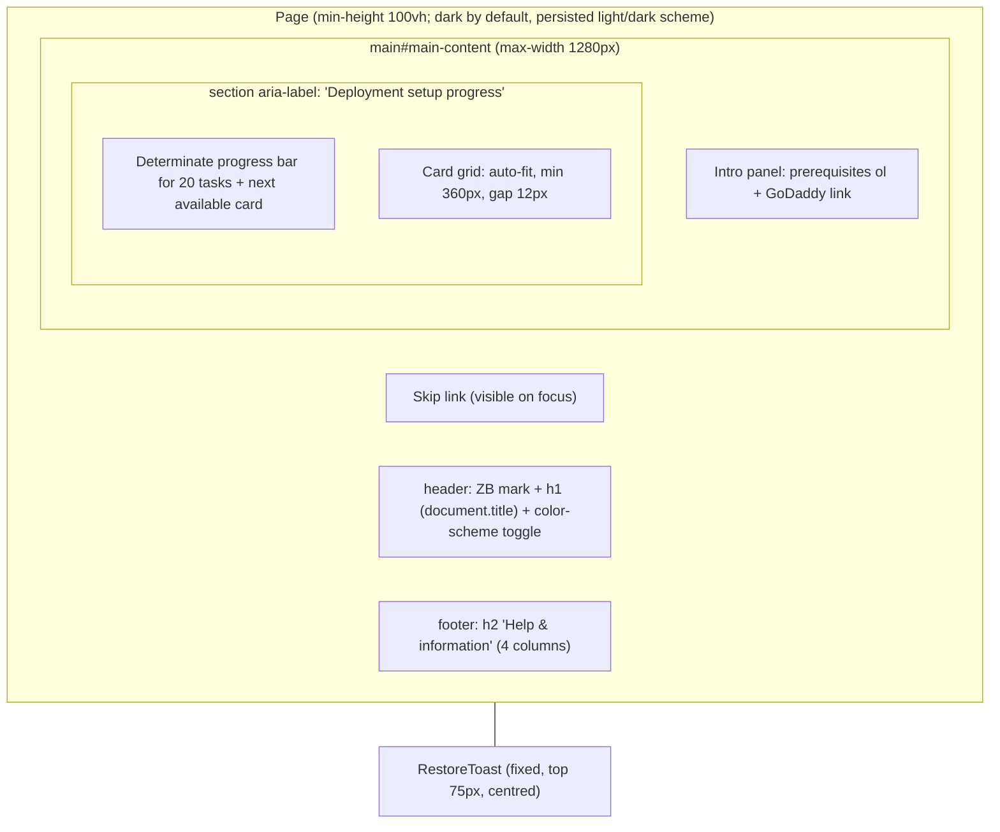
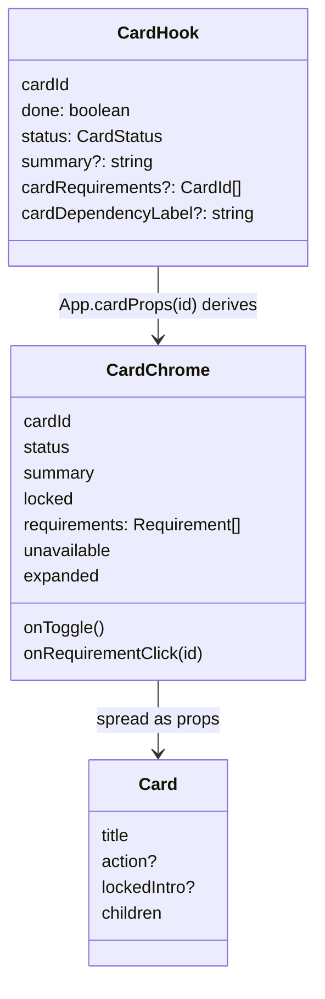
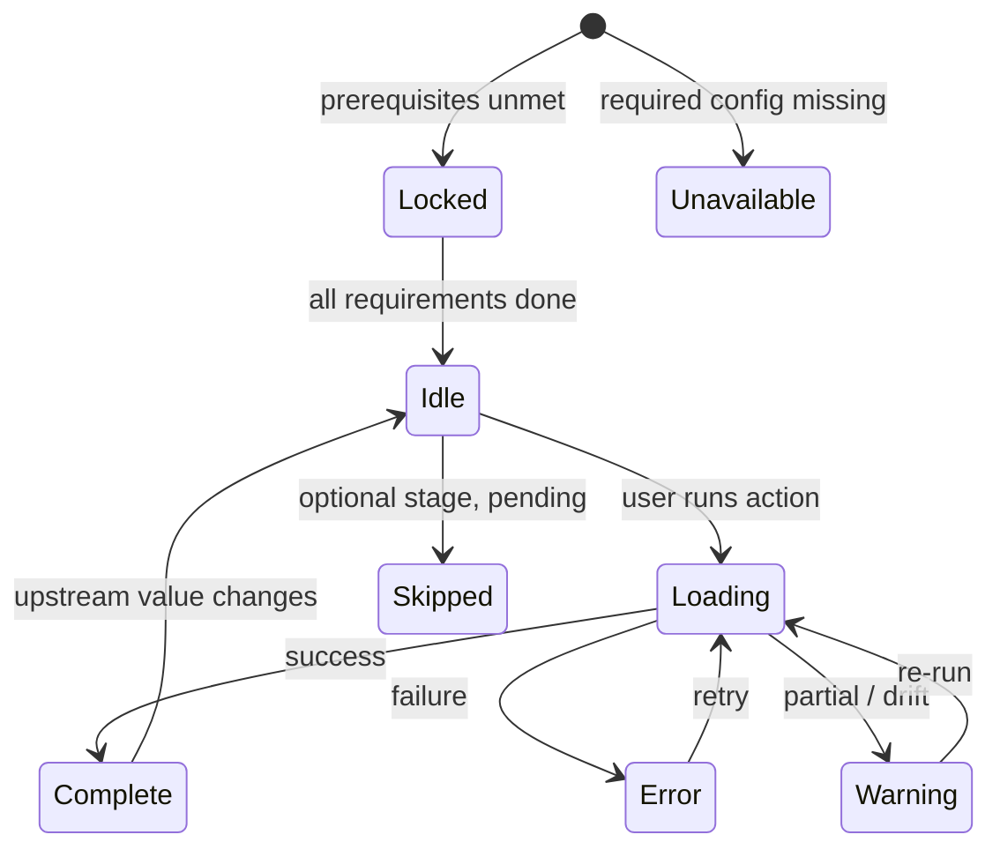
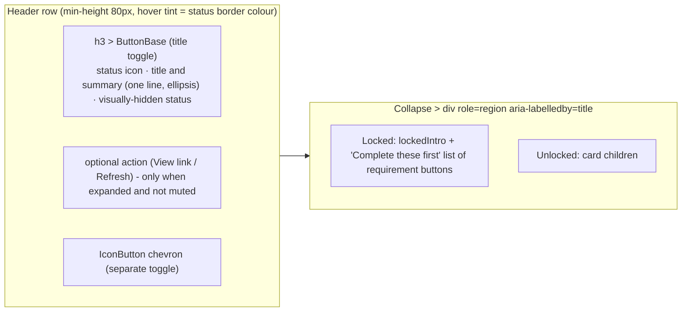
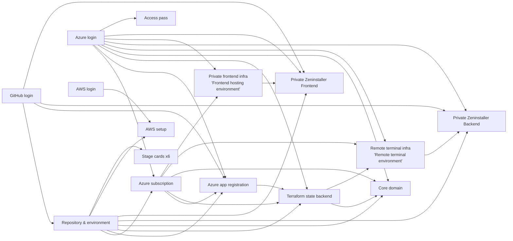
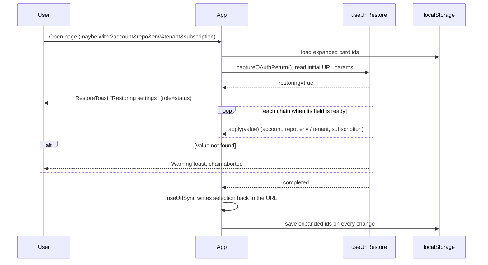
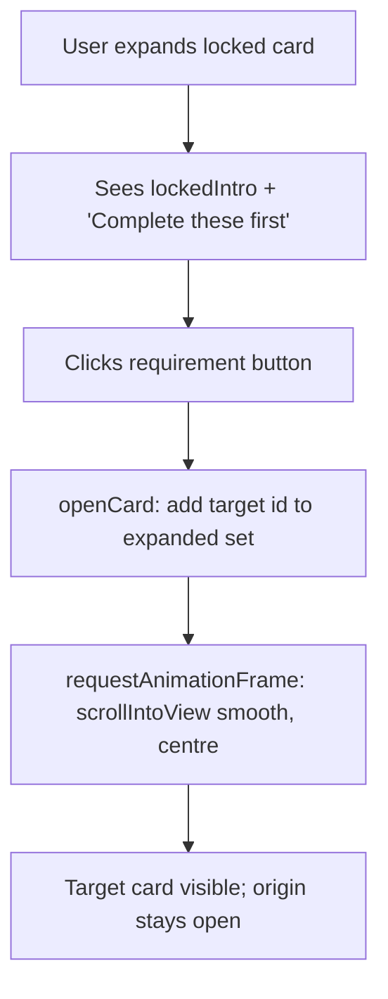
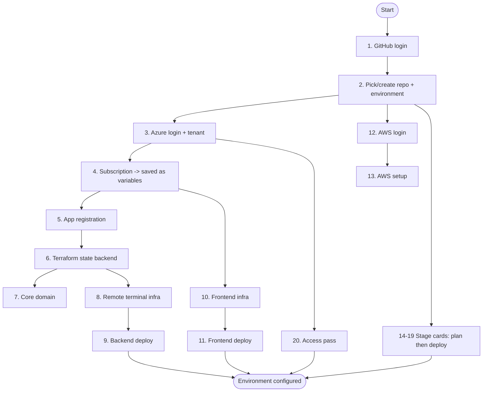
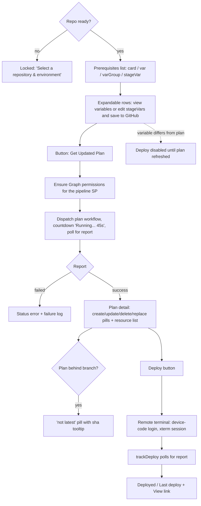

# ZenInstaller UI/UX

Analysis of the installer UI in `corp-src/` (the `zeninstallerPvt/ui` workspace folder): structure, interaction model, design system, accessibility and open issues. Companion documents: [README.md](README.md) (design decisions) and [corp-src/CSS_STANDARDISATION.md](corp-src/CSS_STANDARDISATION.md) (styling migration history).

Stack: React + MUI (`createTheme` with CSS variables), Vite, no router (single page), xterm.js for the remote terminal.

---

## 1. Concept

A single-page, card-based **checklist dashboard**. Each card is one setup task (sign in, pick a repo, create Azure resources, run a Terraform stage). Cards:

- can be completed **in any order**; a card whose prerequisites are unmet is **locked** and lists what to do first (each item is a link that jumps to the card that resolves it);
- report their own state (`status` and `summary`), shown on the collapsed face;
- are expanded/collapsed independently (not a strict accordion), and the open set is persisted.

There is no wizard or global navigation; a completion summary and next-action cue complement the dependency graph between cards.

---

## 2. Page anatomy

| Region | Component | Notes |
|---|---|---|
| Skip link | `Link.visually-hidden.skip-link` in [App.tsx](corp-src/App.tsx) | Revealed on `:focus-visible` by [App.css](corp-src/App.css); targets `#main-content` (`tabIndex=-1`). |
| Header | [Header.tsx](corp-src/components/Header.tsx) | 28px gradient "ZB" mark, the single page `h1` (`document.title`), and a labelled dark/light scheme toggle. Dark is the default; MUI persists the selection. |
| Intro | inline in `App.tsx` + [CardIntro](corp-src/components/CardIntro.tsx) | Ordered list of prerequisites (personal email, org/domain name) with a secure `ExternalLink` to GoDaddy. |
| Progress and card grid | inline in `App.tsx` / `groupSx` in [config/cardLayout.ts](corp-src/config/cardLayout.ts) | One section named "Deployment setup progress" contains a determinate bar for the 20 rendered tasks and a next-step button, followed by the auto-fitting card grid. It does not display a numeric completion count or a separate "Deployment steps" heading. Expanded cards span `1 / -1`. |
| Footer | [Footer.tsx](corp-src/components/Footer.tsx) | Shortcut help dialog (`?` opens outside editable fields), Contact (placeholder), Privacy policy, Terms of use (placeholder), and Support documentation. |
| Restore toast | [RestoreToast.tsx](corp-src/components/RestoreToast.tsx) | Polite `status` while restoring URL state; dismissible warning when a value cannot be restored. |

Responsive behaviour is intrinsic to the grid (3 to 2 to 1 columns as width shrinks) plus `xs`/`sm` MUI breakpoints for padding and for hiding button text labels (`RefreshButton`, `SaveButton`, `ViewLink`; the accessible name is kept).

---

## 3. Card model

### 3.1 Contract

Every card is backed by a hook that implements `CardHook` ([types.ts](corp-src/types.ts)):

`App.cardProps(id)` is the single place where hook state becomes visual chrome:

1. `requirements` = the card's `cardRequirements` whose target hook is not `done`, labelled with the target's `cardDependencyLabel`.
2. `locked` = there is at least one unmet requirement (unless the card is `unavailable`, which suppresses requirements).
3. A locked card's status is forced to `idle`, so it never shows a stale warning.

### 3.2 States

| `CardStatus` | Meaning | Border | Icon | Summary colour |
|---|---|---|---|---|
| `idle` | Not started / action needed | `#fed7aa` | hollow circle (orange) | `#b45309` |
| `loading` | In progress | `#e2e8f0` | hollow circle (blue) | `#64748b` |
| `complete` | Done | `#bbf7d0` | filled check (green) | `#15803d` |
| `warning` | Needs attention (for stages: ready to deploy) | `#fed7aa` | warning triangle (orange) | `#b45309` |
| `error` | Failed | `#fecaca` | outlined `!` (red) | `#dc2626` |
| `skipped` | Optional, not run | `#f1f5f9` | hollow circle (grey) | `#64748b` |
| `unavailable` | Misconfigured (missing env var) | divider, muted | warning triangle (grey) | `#64748b` |
| *locked* (overlay) | Prerequisites unmet | divider, muted bg `#f8fafc` | block glyph (grey) | none shown |

The values in this table describe the light scheme. The dark scheme has corresponding status colors in the theme. Locked and unavailable share the same muted chrome; only the glyph differs. An unavailable card still shows its summary (it is the error message) and `ConfigErrorNotice`.

### 3.3 Anatomy of one card ([Card.tsx](corp-src/components/Card.tsx))

Key behaviours:

- Outer element `id="card-<cardId>"` (test contract and jump-to target).
- Collapsed title and summary each occupy one line and ellipsize, keeping card faces the same height; full text remains in the DOM and accessible name, with a `title` attribute.
- Both toggles carry `aria-expanded` and `aria-controls`; the chevron has an explicit "Expand/Collapse <title>" label.
- A locked card still expands, to show what is missing; its live content is not rendered.
- Ripples are disabled; focus shows a 2px blue outline plus a 3px 12% halo.
- Width transition 0.25s (suppressed by reduced motion).

---

## 4. Dependency graph and card catalogue

### 4.1 Prerequisites

Edges mean "must be complete before". Declared in each `use*Card` hook's `cardRequirements`.

### 4.2 Catalogue (render order)

| # | `cardId` | Title | Requires | Purpose | Source |
|---|---|---|---|---|---|
| 1 | `github_login` | GitHub login | none | PAT or OAuth sign-in; shows signed-in user; sign-out | [GithubLogin](corp-src/cards/GithubLogin) |
| 2 | `repo` | Repository & environment | `github_login` | Select account, repo (or create from template, optionally all branches / auto-create PROD+TEST envs), pick environment/branch; shows PR state | [Repo](corp-src/cards/Repo) |
| 3 | `azure_login` | Azure login | none | MSAL sign-in, tenant selection (or manual tenant id), sign-out | [AzureLogin](corp-src/cards/AzureLogin) |
| 4 | `azure_subscription` | Choose Azure subscription | `azure_login`, `repo` | Pick subscription; saves ids as GitHub variables; drift detection | [AzureSubscription](corp-src/cards/AzureSubscription) |
| 5 | `azure_app_registration` | Create an app registration in Azure | `github_login`, `azure_login`, `repo`, `azure_subscription` | Creates the GitHub-Actions service principal and federated credential; RBAC check | [AzureAppRegistration](corp-src/cards/AzureAppRegistration) |
| 6 | `core_infra` | Terraform state backend | `azure_login`, `repo`, `azure_subscription`, `azure_app_registration` | Company short code, location; creates state storage; checklist of steps | [CoreInfra](corp-src/cards/CoreInfra) |
| 7 | `create_domain` | Core domain | `azure_login`, `repo`, `azure_subscription`, `core_infra` | Creates the corp domain resources | [CreateDomain](corp-src/cards/CreateDomain) |
| 8 | `remote_terminal_infra` | Remote terminal environment | `azure_login`, `azure_subscription`, `core_infra` | Provisions relay for the remote terminal; connection details | [RemoteTerminalInfra](corp-src/cards/RemoteTerminalInfra) |
| 9 | `backend_deploy` | Private Zeninstaller Backend | `github_login`, `repo`, `azure_login`, `remote_terminal_infra` | Build and deploy the Function App backend | [BackendDeploy](corp-src/cards/BackendDeploy) |
| 10 | `private_frontend_infra` | Frontend hosting environment | `azure_login`, `azure_subscription` | Storage static site / hosting infra | [PrivateFrontendInfra](corp-src/cards/PrivateFrontendInfra) |
| 11 | `web_deploy` | Private Zeninstaller Frontend | `github_login`, `repo`, `azure_login`, `private_frontend_infra` | Build and upload the frontend | [WebDeploy](corp-src/cards/WebDeploy) |
| 12 | `aws_login` | AWS login | none | Bootstrap access key, MFA code | [AwsLogin](corp-src/cards/AwsLogin) |
| 13 | `aws_setup` | AWS setup | `aws_login`, `repo` | Creates IAM role for GitHub OIDC; connection details | [AwsSetup](corp-src/cards/AwsSetup) |
| 14-19 | `stage_<dir>` | Subscription Budget, Global groups, User accounts, AWS Entra SSO, AWS Entra SSO P2, CloudFront | `repo` (+ per-stage prerequisites inside) | Terraform plan, review, deploy through the remote terminal | [Stage](corp-src/cards/Stage) |
| 20 | `access_pass` | Access pass | `azure_login` | Generates user access pass; copy rows, confirmation checkbox | [AccessPass](corp-src/cards/AccessPass) |

Notes:

- `global_groups` ([GlobalGroups](corp-src/cards/GlobalGroups)) has a hook and component but is **not rendered** in `App.tsx`; the equivalent flow is the `c02globalGroups` stage.
- Stage definitions live in [logic/pipeline.ts](corp-src/logic/pipeline.ts): `c01subscription`, `c02globalGroups`, `c07userAccounts`, `c20awsentrasso`, `c21awsentrassoP2`, `c25cloudfront`.

---

## 5. Key flows

### 5.1 Page load, restore and persistence

- Two independent chains: GitHub (`account`, `repo`, `env`) and Azure (`tenant`, `subscription`). A 10s timeout guards each.
- User interaction with a field cancels restoration of its keys (`urlRestore.cancel`).
- Expanded state key: `zeninstaller_corp_expanded_cards`.

### 5.2 Locked card to prerequisite

### 5.3 Typical end-to-end journey

The order is a recommendation; the UI enforces only the per-card prerequisites in 4.1.

### 5.4 Stage card (Terraform plan and deploy)

Stage status mapping ([logic/stage.ts](corp-src/logic/stage.ts)): `deployed` to `complete`, `success` (ready to deploy) to `warning`, `failed` to `error`, `skipped` to `skipped`, `pending` to `idle`, in-flight run to `idle` with "Status update required", loading to `loading`. "No changes" counts as deployed.

Remote terminal ([RemoteTerminal.tsx](corp-src/cards/Stage/RemoteTerminal.tsx)): status bar (`role=status`) cycles `registering`, `dispatching`, `negotiating`, `connecting`, `connected`, `reconnecting`, `closed`, `error`; shows runner stage label, short session id, End session; a device-code panel with copyable code and link; then an xterm instance (120x24).

---

## 6. Component inventory

### 6.1 Shared components ([components/](corp-src/components))

| Component | Role | Semantics |
|---|---|---|
| `Card` | Collapsible card shell | h3 + button, region, `aria-expanded/controls` |
| `Header` / `Footer` | Page chrome | `header`, `footer`, h1 / h2 + h3 |
| `RestoreToast` | URL-restore feedback | `role=status` / MUI Alert (`alert`) |
| `CardIntro` | Intro paragraph (`p`, body2, secondary) | none |
| `Caption` | Small helper text | `span`, caption |
| `FieldLabel` | `FormLabel` bound with `htmlFor` | labels inputs |
| `ErrorText` | Error message | `role=alert` |
| `StatusText` | Progress/success message | `role=status`, `aria-live=polite` |
| `ConfigErrorNotice` | "Card isn't configured correctly" panel | none (see issues) |
| `ExternalLink` | Inline new-tab link | `aria-label="<label> (opens in new tab)"`, `rel=noopener noreferrer` |
| `ViewLink` | Outlined "View" button-link, text hidden at `xs` | same new-tab naming; `title=href` |
| `RefreshButton` | Refresh, then Done / Failed (transient) | `aria-label` tracks text |
| `SaveButton` | "Save N variables / Update N secrets" | `aria-label` tracks text; spinner when busy |
| `CopyRow` | Label + value + Copy; optional masking | value `data-sensitive`; button named "Copy <label>"; "Copied" in `aria-live` |
| `VariablesCard` | Editable GitHub variable list | label per input, clear/revert buttons, dirty/error/success row tints |
| `SecretsCard` | Secret presence/validity list + edit dialog | masked by default, reveal toggle, validation badges |
| `StepRow` (cards/) | One line of a progress checklist | icon + label + detail + determinate bar |

### 6.2 Common controls and patterns

| Pattern | Implementation |
|---|---|
| Primary action | `Button variant="contained"` with 135deg blue gradient (theme override); disabled flattens to `#f1f5f9` / `#cbd5e1` |
| Destructive action | `color="error" variant="contained"` red gradient (sign-out) |
| Secondary action | `variant="outlined"` (Deploy status update, shortcuts, View) |
| Text field | MUI `TextField` small; class `corpEditor` (monospace, tinted bg, dirty = amber border, error = red) and `corpTechnicalInput` for IDs/keys |
| Sensitive values | `data-sensitive="true"`; `:root[data-mask-sensitive="true"]` blurs them (opt-in) |
| Progress | `CircularProgress` size 12-16 with accessible name; `LinearProgress` 4px for step progress |
| Status pill | bordered box, text label plus colour (plan create/update/delete/replace, `not latest`, `valid`/`invalid`) |
| Tooltips | variable descriptions (info icon), revert, plan-diff warning icon, `not latest` pill, repo options |
| Dialogs | Footer shortcuts dialog (open with `?`, close with Escape); secrets edit dialog |
| Dark panel | Remote terminal only (`TERMINAL_COLORS`, Catppuccin-like) |

---

## 7. Design system

Source of truth: [theme.ts](corp-src/theme.ts) (MUI theme, CSS variables) and [App.css](corp-src/App.css) (global helpers). Layout tokens `--card-w` (360px) and `--card-w-expanded` (1280px) are set in [corp.tsx](corp-src/corp.tsx) from [config/cardLayout.ts](corp-src/config/cardLayout.ts).

### 7.1 Colour

| Token | Value | Use |
|---|---|---|
| `primary` main / dark / light | `#2563eb` / `#1d4ed8` / `#60a5fa` | actions, focus ring, links, requirement text |
| `error` main / dark / light | `#dc2626` / `#b91c1c` / `#ef4444` | errors, destructive |
| `warning` main / dark / light | `#d97706` / `#b45309` / `#ea580c` | drift, dirty, update |
| `success` main / dark / light | `#16a34a` / `#15803d` / `#22c55e` | done, create |
| `text` primary / secondary / muted | `#0f172a` / `#475569` / `#64748b` | body / supporting / hints, disabled |
| `divider` | `#e2e8f0` | borders |
| `background` default / paper | `#f8fafc` / `#ffffff` | page / surfaces |
| `card.*` | per-status border, icon, dark-contrast summary; muted bg `#f8fafc`; muted text `#94a3b8`; radius 10px; shadows | card chrome (typed `theme.palette.card`) |

Visual language: selectable light or dark slate-neutral schemes with a blue brand accent; dark is the default and the user's choice persists. Status is carried by a coloured 1px border, glyph, and text. The palette table above lists light-scheme values; `theme.ts` defines both schemes.

### 7.2 Typography

Only `sans-serif` (UI) and `monospace` (technical values) are permitted; no web fonts. Sizes stay within 0.75-1rem.

| Variant | Size / weight | Use |
|---|---|---|
| `h1` | 1rem / 600 | page title |
| `h2` | 0.875rem / 600 | section titles |
| `h3` | 0.75rem / 600 | sub-headings |
| `body1` | 1rem | card titles, summaries, content |
| `body2` | 0.875rem | intro, helper, footer |
| `caption` | 0.75rem | small, also used to size icons |
| `fieldLabel` | 1rem / 600, `#475569` | form labels |
| `sectionLabel` | 1rem / 700, `#0f172a` | in-card section headings |
| `technical` / `technicalBody` | monospace 0.75 / 1rem | IDs, values, terminal |
| `button` | 0.875rem / 600, no transform (MUI root override raises to 1rem) | buttons |

### 7.3 Spacing, shape, elevation, motion

- Spacing on MUI 8px unit: grid gap 1.5 (12px), card header `px 2 py 1.5`, card body `px/py 2.5`.
- Shape: base radius 8; card 10; editor fields 6; pills 4.
- Elevation: resting `0 1px 3px rgba(0,0,0,.04)`; hover `0 4px 12px rgba(15,23,42,.12)`; toasts `0 4px 16px rgba(0,0,0,.12)`.
- Hover: only the card header tints (`color-mix(border 20%, white)`).
- Motion: width/border/shadow transitions 0.2-0.25s, collapse, pulse on terminal status dot, smooth scroll to cards; all neutralised under `prefers-reduced-motion`.

### 7.4 Enforcement

ESLint ([eslint.config.js](eslint.config.js)): recommended `jsx-a11y`; `no-restricted-syntax` blocks raw hex, `fontFamily`, `fontSize` in JSX `sx` under `corp-src/cards` and `corp-src/components`. Known allowed exceptions: terminal colours (`TERMINAL_COLORS`) and theme-internal literals.

---

## 8. Accessibility

### 8.1 Implemented

| Area | Implementation |
|---|---|
| Landmarks / headings | skip link, `header`, `main`, `footer`; one `h1`; `h2` "Deployment setup progress" and "Help & information"; cards are `h3` |
| Keyboard | native `button`/`a`/inputs only; title and chevron are separate tab stops; Enter/Space toggle; requirement rows are buttons |
| Focus | global `:focus-visible` (2px blue + halo) and explicit card focus styles; skip link focus reveal |
| Names | toggle name = visible title + summary + hidden status ("Locked" wins); icon-only buttons labelled; new-tab links announce "(opens in new tab)"; inputs tied to `FieldLabel` |
| Status | decorative icons `aria-hidden`; `StatusText` / `ErrorText` give `status` / `alert`; terminal status bar `role=status`; toast `status` |
| Motion | global `prefers-reduced-motion` reset |
| Reflow | fluid grid; automated check at 320px |
| Colour independence | status always has text (summary, hidden status, pill text), not colour alone |
| Privacy | opt-in blur for `data-sensitive` content; secrets masked by default |
| Automated tests | `@axe-core/playwright` scans (collapsed, expanded, locked), card-height/accessibility-name regression, dark/light toggle and persistence, footer shortcut dialog checks, and Tab/Enter/Space sweep in [CardAccessibility.spec.mts](pwtests/corp-src/mock-tests/CardAccessibility.spec.mts); 320px reflow, forced-colors and reduced-motion emulation |
| Shortcuts | `?` opens footer help when focus is outside input, textarea, select, and contenteditable controls; Escape closes the modal; other listed keys use native control behavior |

The footer dialog lists the supported behavior: `?` opens help; Tab/Shift+Tab moves focus; Enter/Space activates a focused button; Enter follows a focused link or runs a focused control's supported action; Escape closes the dialog. The `?` handler ignores Ctrl/Meta/Alt combinations and editable targets.

### 8.2 Accepted exceptions (documented)

Muted card titles (`#94a3b8`) remain below 4.5:1 by design and are excluded from axe via `data-a11y-contrast-exception`. Status summary text now uses darker palette shades; other axe rules stay on.

### 8.3 Not yet validated

Manual 200% zoom reflow, keyboard-only end-to-end run, screen-reader announcements, and Windows high-contrast checks (Step 10 in `CSS_STANDARDISATION.md`).

---

## 9. Findings and recommendations

Observed from source review; none of these have been confirmed with assistive technology.

| # | Severity | Finding | Recommendation |
|---|---|---|---|
| 1 | Medium | Two cards shared the title "Private Zeninstaller Environment" (`remote_terminal_infra`, `private_frontend_infra`); screen-reader and tab users could not tell them apart. | Resolved: titles are now "Remote terminal environment" and "Frontend hosting environment". |
| 2 | Medium | Intro panel and footer panel used `sx={{ background: "background.paper" }}`. | Resolved: both now use `bgcolor: "background.paper"`. |
| 3 | Medium | Information is tooltip-only on non-focusable elements: variable description (`InfoOutlinedIcon`), the "Changed since last plan" warning icon (also `aria-hidden`), and the `not latest` pill. Keyboard and screen-reader users miss it. | Make triggers focusable with accessible names, or render the text inline / via `aria-describedby`. |
| 4 | Medium | Status text used `success.main`, `warning.main`, and `error.light`, which fall short of 4.5:1 on white. | Resolved: status summaries and text use dark shades; lighter shades remain on icons, borders and backgrounds. |
| 5 | Medium | `StepRow` conveys state by icon only (no `aria-hidden`, no text), so progress state is invisible to screen readers. | Add hidden status text per row and a `role=status` summary. |
| 6 | Low | `ConfigErrorNotice` has no `role`; the message is only exposed when the card is opened. | Add `role="alert"`/`status` or reference it from the summary. |
| 7 | Low | Card titles use single-line ellipsis, which can hide text visually on touch screens. | Resolved for assistive technology: the full title and summary remain in the toggle's accessible name and in `title` attributes. Visual truncation remains intentional to keep card headers aligned. |
| 8 | Low | Header "ZB" mark is read as text before the `h1`; the `h1` text is `document.title`, so it depends on `index.html`. | Mark the logo `aria-hidden`; keep the title static in the header or assert it in a test. |
| 9 | Low | Expanding a card makes it span the full grid width and reflows neighbours, which can shift focus position and context. | Keep the existing scroll-into-view, and consider restoring focus/scroll after toggle. |
| 10 | Low | The page had no overall progress indicator or recommended-next-step cue. | Resolved: the page reports completed tasks out of 20 and provides a button to open the first incomplete, unlocked card. |
| 11 | Low | Footer Contact and Terms content are placeholders. | Provide content or remove the entry points before release. Keyboard shortcuts help is now implemented. |
| 12 | Low | Icons are sized via `typography: "caption"` (about 12px), and `IconButton size="small"` targets are about 30px. | Acceptable for WCAG 2.2 AA (24px), but consider larger targets on touch. |
| 13 | Info | `GlobalGroupsCard` is built, tested and unused in `App.tsx`. | Remove or render it. |
| 14 | Info | Disabled primary buttons in the light scheme (`#cbd5e1` on `#f1f5f9`) are very faint; exempt from contrast rules but hard to see as buttons. | Add a border or lighter-weight outline style. |
| 15 | Info | Destructive actions (sign-out, end session) are one click with no confirmation. | Consider confirmation where state is lost. |

---

## 10. Verification map

| Concern | Where |
|---|---|
| Card behaviour (hooks) | `corp-src/test/*.test.tsx` (Vitest) |
| Shared component semantics | `SharedBuildingBlocks.browser.test.tsx` |
| Visual and flow regression (mocked backends) | [pwtests/corp-src/mock-tests](pwtests/corp-src/mock-tests) with snapshots under `pwtests/corp-src/snapshots/mock-tests` |
| Accessibility sweeps | [CardAccessibility.spec.mts](pwtests/corp-src/mock-tests/CardAccessibility.spec.mts) |
| Live integration | [pwtests/corp-src/integration-tests](pwtests/corp-src/integration-tests) (auth set-up projects) |
| Test hooks (UI contract) | `id="card-<id>"`, `data-id`, `data-sensitive`, accessible names; see README design decision 6 |
