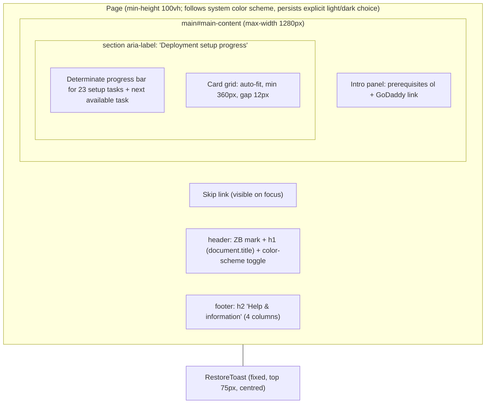
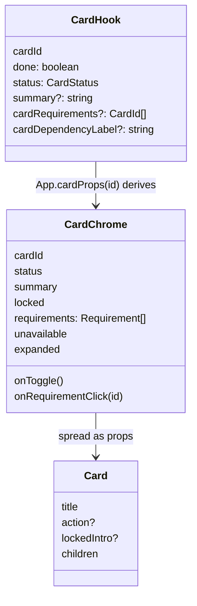
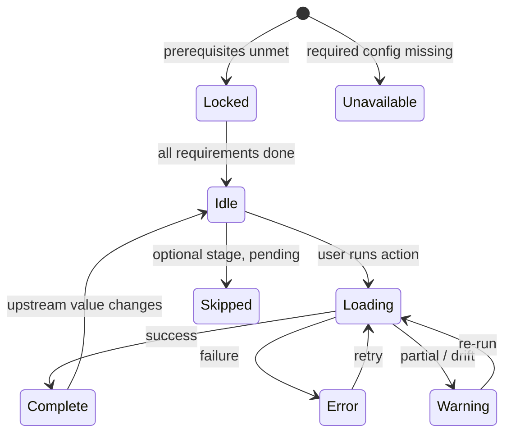
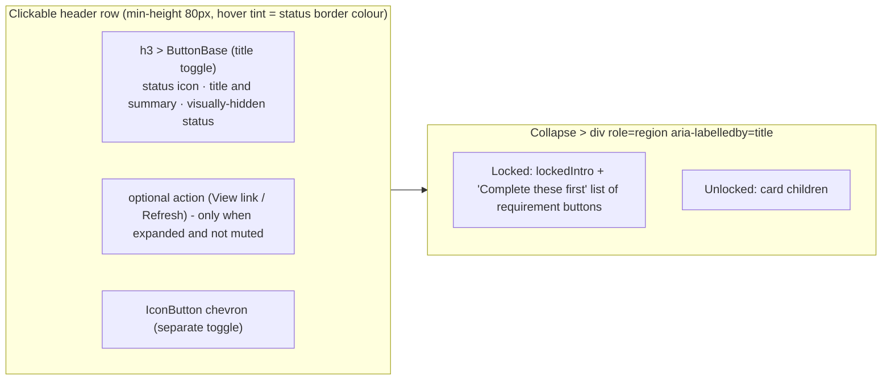
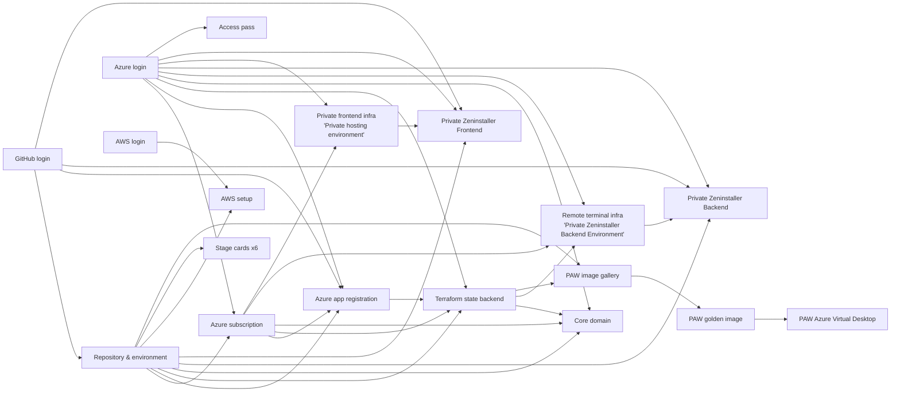
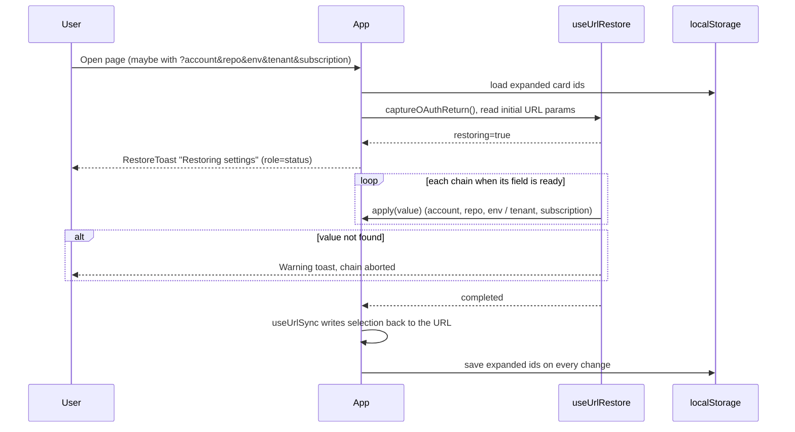
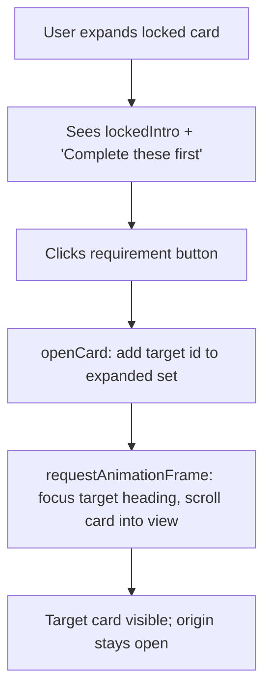
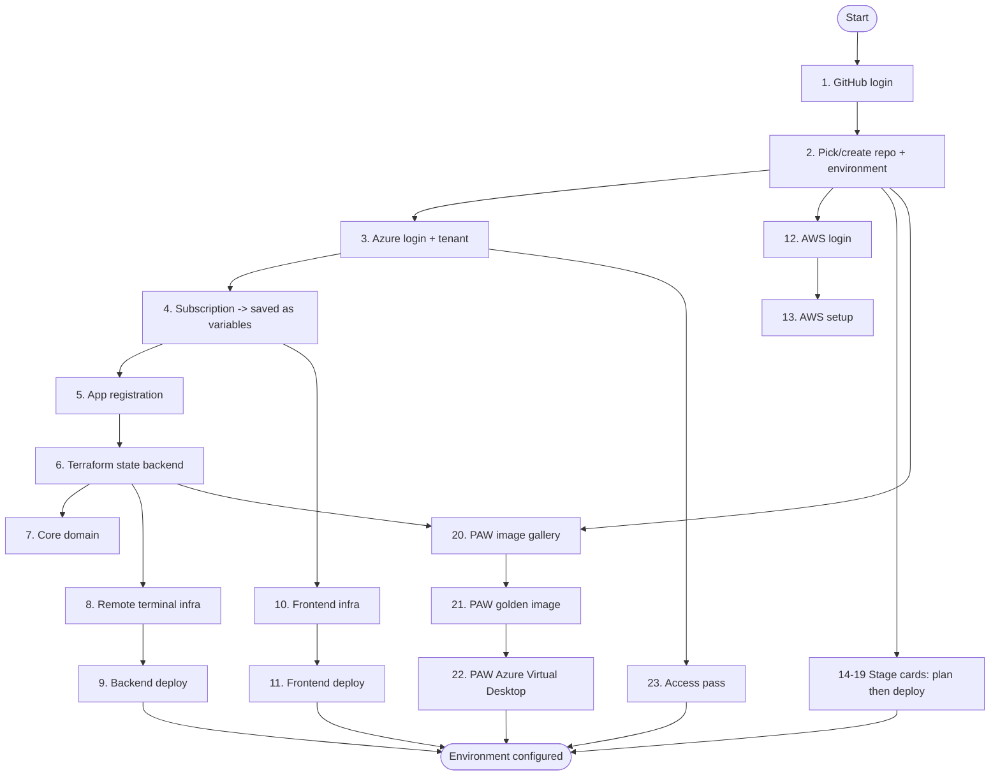
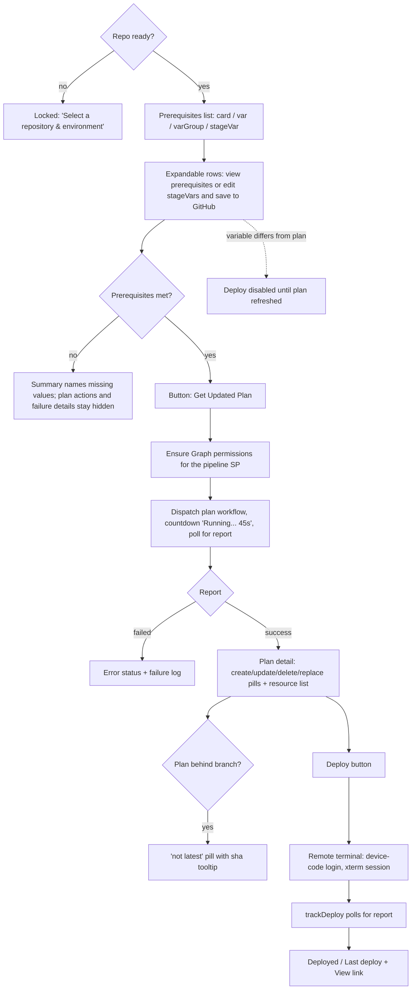

# ZenInstaller UI/UX

Analysis of the installer UI in `corp-src/` (the `zeninstallerPvt/ui` workspace folder): structure, interaction model, design system, accessibility and open issues. Companion document: [README.md](README.md) (design decisions); current UI behavior, styling, accessibility, verification and open issues are covered here.

Stack: React + MUI (`createTheme` with CSS variables), Vite, no router (single page), xterm.js for the remote terminal.

---

## 1. Concept

A single-page, card-based **checklist dashboard**. It contains 23 tracked setup tasks (sign in, pick a repo, create Azure resources, run Terraform stages, and deploy a privileged access workstation) and an optional GitHub signup helper. Cards:

- can be completed **in any order**; a card whose prerequisites are unmet is **locked** and lists what to do first (each item is a link that jumps to the card that resolves it);
- report their own state (`status` and `summary`) in both collapsed and expanded headers;
- are expanded/collapsed independently (not a strict accordion), and the open set is persisted.

There is no wizard or global navigation; a completion summary and next-action cue complement the dependency graph between cards.

---

## 2. Page anatomy



| Region | Component | Notes |
|---|---|---|
| Skip link | `Link.visually-hidden.skip-link` in [App.tsx](corp-src/App.tsx) | Revealed on `:focus-visible` by [App.css](corp-src/App.css); targets `#main-content` (`tabIndex=-1`). |
| Header | [Header.tsx](corp-src/components/Header.tsx) | Decorative 28px gradient "ZB" mark (`aria-hidden`), the single page `h1` (`document.title`), and a labelled System/Light/Dark scheme cycle. System honors the browser's reported light or dark preference; unavailable preference detection falls back to dark. MUI persists explicit Light/Dark selections. |
| Intro | inline in `App.tsx` + [CardIntro](corp-src/components/CardIntro.tsx) | Ordered list of prerequisites (personal email, org/domain name) with a secure `ExternalLink` to GoDaddy. |
| Progress and card grid | inline in `App.tsx` / `groupSx` in [config/cardLayout.ts](corp-src/config/cardLayout.ts) | One section named "Deployment setup progress" contains a determinate bar for the 23 setup tasks and a next-step button, followed by the auto-fitting grid. The optional GitHub signup helper is rendered in the grid but excluded from task progress. It does not display a numeric completion count or a separate "Deployment steps" heading. Expanded cards span `1 / -1`. |
| Footer | [Footer.tsx](corp-src/components/Footer.tsx) | Shortcut help dialog (`?` opens outside editable fields), contact placeholder, Privacy policy, Terms of use placeholder, and Support documentation; the footer content has no subgroup headings. |
| Restore toast | [RestoreToast.tsx](corp-src/components/RestoreToast.tsx) | Polite `status` while restoring URL state; dismissible warning when a value cannot be restored. |

Responsive behaviour is intrinsic to the grid (3 to 2 to 1 columns as width shrinks) plus `xs`/`sm` MUI breakpoints for padding and for hiding button text labels (`RefreshButton`, `SaveButton`, `ViewLink`; the accessible name is kept).

---

## 3. Card model

### 3.1 Contract

Every card is backed by a hook that implements `CardHook` ([types.ts](corp-src/types.ts)):



`App.cardProps(id)` is the single place where hook state becomes visual chrome:

1. `requirements` = the card's `cardRequirements` whose target hook is not `done`, labelled with the target's `cardDependencyLabel`.
2. `locked` = there is at least one unmet requirement (unless the card is `unavailable`, which suppresses requirements).
3. A locked card's status is forced to `idle`, so it never shows a stale warning.

### 3.2 States

| `CardStatus` | Meaning | Border | Icon | Summary colour |
|---|---|---|---|---|
| `idle` | Not started / action needed | `#fed7aa` | hollow circle (orange) | `#b45309` |
| `loading` | In progress | `#e2e8f0` | hollow circle (blue) | `#64748b` |
| `complete` | Done | `#bbf7d0` | filled check (green) | `#15803d` |
| `warning` | Needs attention or a recoverable action (stage: ready to deploy or unmet stage prerequisites) | `#fed7aa` | warning triangle (orange) | `#b45309` |
| `error` | Failed | `#fecaca` | outlined `!` (red) | `#dc2626` |
| `skipped` | Optional, not run | `#f1f5f9` | hollow circle (grey) | `#64748b` |
| `unavailable` | Misconfigured (missing env var) | divider, muted | warning triangle (grey) | `#64748b` |
| *locked* (overlay) | Prerequisites unmet | divider, muted bg `#f8fafc` | block glyph (grey) | muted requirement labels |

The values in this table describe the light scheme. The dark scheme has corresponding status colors in the theme. Locked and unavailable share the same muted chrome; only the glyph differs. An unavailable card still shows its summary (it is the error message) and `ConfigErrorNotice`.



### 3.3 Anatomy of one card ([Card.tsx](corp-src/components/Card.tsx))



Key behaviours:

- Outer element `id="card-<cardId>"` (test contract and jump-to target).
- Clicking anywhere in the header toggles the card. The title and chevron are separate labelled, keyboard-operable controls; an expanded-card action stops propagation so it does not collapse the card.
- Collapsed title and summary each occupy one line and ellipsize, keeping card faces the same height; full text remains in the DOM and accessible name, with a `title` attribute.
- Expanded headers keep the summary beside the heading and wrap on narrow screens. Locked summaries show direct requirement labels such as "Sign in to AWS"; blocked stage summaries name missing values directly (for example, "CONTACT_EMAILS not set"), and failed-plan summaries say "Plan failed; check the GitHub Actions run" without a redundant "Failed:" prefix.
- Both toggles carry `aria-expanded` and `aria-controls`; the chevron has an explicit `Expand/Collapse <title>` label.
- A locked card still expands, to show its optional read-only introduction and unmet requirements; its live content is not rendered. Pipeline-stage descriptions are shown for both locked and unlocked stages.
- Ripples are disabled; focus shows a 2px blue outline plus a 3px 12% halo.
- Width transition 0.25s (suppressed by reduced motion).

---

## 4. Dependency graph and card catalogue

### 4.1 Prerequisites



Edges mean "must be complete before". Declared in each `use*Card` hook's `cardRequirements`.

### 4.2 Catalogue (23 progress tasks; helper rendered after task 1)

| # | `cardId` | Title | Requires | Purpose | Source |
|---|---|---|---|---|---|
| 1 | `github_login` | GitHub login | none | PAT or OAuth sign-in; shows signed-in user; sign-out | [GithubLogin](corp-src/cards/GithubLogin) |
| — | `github_signup` | GitHub Sign Up | none; optional | Opens GitHub signup in a new tab with the entered email; signup is completed on GitHub. The email is sent only when the user submits; this helper is not included in setup progress. | [GithubSignup](corp-src/cards/GithubSignup) |
| 2 | `repo` | Repository & environment | `github_login` | Select account, repo (or create from template, optionally all branches / auto-create PROD+TEST envs), pick environment/branch; shows PR state | [Repo](corp-src/cards/Repo) |
| 3 | `azure_login` | Azure login | none | MSAL sign-in, tenant selection (or manual tenant id), sign-out | [AzureLogin](corp-src/cards/AzureLogin) |
| 4 | `azure_subscription` | Choose Azure subscription | `azure_login`, `repo` | Pick subscription; saves ids as GitHub variables; drift detection | [AzureSubscription](corp-src/cards/AzureSubscription) |
| 5 | `azure_app_registration` | Create an app registration in Azure | `github_login`, `azure_login`, `repo`, `azure_subscription` | Creates the GitHub-Actions service principal and federated credential; RBAC check | [AzureAppRegistration](corp-src/cards/AzureAppRegistration) |
| 6 | `core_infra` | Terraform state backend | `azure_login`, `repo`, `azure_subscription`, `azure_app_registration` | Company short code, location; creates state storage; checklist of steps | [CoreInfra](corp-src/cards/CoreInfra) |
| 7 | `create_domain` | Core domain | `azure_login`, `repo`, `azure_subscription`, `core_infra` | Creates the corp domain resources | [CreateDomain](corp-src/cards/CreateDomain) |
| 8 | `remote_terminal_infra` | Private Zeninstaller Backend Environment | `azure_login`, `azure_subscription`, `core_infra` | Provisions relay for the remote terminal; connection details | [RemoteTerminalInfra](corp-src/cards/RemoteTerminalInfra) |
| 9 | `backend_deploy` | Private Zeninstaller Backend | `github_login`, `repo`, `azure_login`, `remote_terminal_infra` | Build and deploy the Function App backend | [BackendDeploy](corp-src/cards/BackendDeploy) |
| 10 | `private_frontend_infra` | Private hosting environment | `azure_login`, `azure_subscription` | Storage static site / hosting infra | [PrivateFrontendInfra](corp-src/cards/PrivateFrontendInfra) |
| 11 | `web_deploy` | Private Zeninstaller Frontend | `github_login`, `repo`, `azure_login`, `private_frontend_infra` | Build and upload the frontend | [WebDeploy](corp-src/cards/WebDeploy) |
| 12 | `aws_login` | AWS login | none | Bootstrap access key, MFA code | [AwsLogin](corp-src/cards/AwsLogin) |
| 13 | `aws_setup` | AWS setup | `aws_login`, `repo` | Creates IAM role for GitHub OIDC; connection details | [AwsSetup](corp-src/cards/AwsSetup) |
| 14-19 | `stage_<dir>` | Azure subscription budget, Organisation security groups, User accounts and sign-in, AWS single sign-on with Entra ID, AWS single sign-on with Entra ID P2, AWS CloudFront distribution | `repo` (+ per-stage prerequisites inside) | Stage-specific description, Terraform plan and review, then deploy through the remote terminal | [Stage](corp-src/cards/Stage) |
| 20 | `privavd_gallery` | PAW image gallery | `repo`, `core_infra` | Creates the Azure Compute Gallery and image definition used to publish the privileged access workstation image | [PrivAvdGallery](corp-src/cards/PrivAvdGallery) |
| 21 | `privavd_image` | PAW golden image | `privavd_gallery` | Builds the Windows 11 privileged access workstation image with Packer and publishes a version to the gallery; the build takes about an hour | [PrivAvdImage](corp-src/cards/PrivAvdImage) |
| 22 | `privavd_paw` | PAW Azure Virtual Desktop | `privavd_image` | Deploys the Azure Virtual Desktop host pool and session host from the newest replicated image version | [PrivAvdPaw](corp-src/cards/PrivAvdPaw) |
| 23 | `access_pass` | Access pass | `azure_login` | Generates user access pass; copy rows, confirmation checkbox | [AccessPass](corp-src/cards/AccessPass) |

Notes:

- `global_groups` ([GlobalGroups](corp-src/cards/GlobalGroups)) has a hook and component but is **not rendered** in `App.tsx`; the equivalent flow is the `GlobalGroups` stage.
- Stage definitions live in [logic/pipeline.ts](corp-src/logic/pipeline.ts): `SubscriptionBudget`, `GlobalGroups`, `UserAccounts`, `AwsEntraSso`, `AwsEntraSsoP2`, `CloudFront`.

---

## 5. Key flows

### 5.1 Page load, restore and persistence



- Two independent chains: GitHub (`account`, `repo`, `env`) and Azure (`tenant`, `subscription`). A 10s timeout guards each.
- User interaction with a field cancels restoration of its keys (`urlRestore.cancel`).
- An MSA or app-result tenant may prefill the Azure tenant field without confirming ARM access. Startup probes use a saved tenant selection; explicit tenant selection confirms only after ARM token acquisition succeeds, and a late startup probe cannot replace a tenant the user has since confirmed.
- Expanded state key: `zeninstaller_corp_expanded_cards`.

### 5.2 Locked card to prerequisite



### 5.3 Typical end-to-end journey



The order is a recommendation; the UI enforces only the per-card prerequisites in 4.1.

### 5.4 Stage card (Terraform plan and deploy)



Stage status mapping ([logic/stage.ts](corp-src/logic/stage.ts)): `deployed` to `complete`; `success` (ready to deploy) and unmet stage prerequisites to `warning`; failed plans to `error`; `skipped` to `skipped`; `pending` and stale plans to `idle`; loading to `loading`. "No changes" counts as deployed. The plan/status-update action, no-plan message, and plan failure output are shown only while current prerequisites are met. Missing values are checked after trimming whitespace, and stage-variable editors remain available to resolve blockers.

Remote terminal ([RemoteTerminal.tsx](corp-src/cards/Stage/RemoteTerminal.tsx)): status bar (`role=status`) cycles `registering`, `dispatching`, `negotiating`, `connecting`, `connected`, `reconnecting`, `closed`, `error`; shows runner stage label, short session id, End session; a device-code panel with copyable code and link; then an xterm instance (120x24).

---

### 5.5 GitHub environment-file decoding

GitHub's Contents API returns environment-file content as Base64. The UI decodes the returned bytes as UTF-8 before parsing, preserving non-ASCII variable values instead of interpreting each byte as a character.

## 6. Component inventory

### 6.1 Shared components ([components/](corp-src/components))

| Component | Role | Semantics |
|---|---|---|
| `Card` | Collapsible card shell | h3 + button, region, `aria-expanded/controls` |
| `Header` / `Footer` | Page chrome | `header`, `footer`, h1 / h2 |
| `RestoreToast` | URL-restore feedback | `role=status` / MUI Alert (`alert`) |
| `CardIntro` | Intro paragraph (`p`, body2, secondary) | none |
| `Caption` | Small helper text | `span`, caption |
| `FieldLabel` | `FormLabel` bound with `htmlFor` | labels inputs |
| `InfoTip` | Keyboard-focusable informational explanation | named `role=img` span, 24px minimum target, focus-visible outline and MUI described tooltip; sensitive tooltip values retain `data-sensitive` |
| `ErrorText` | Error message | `role=alert` |
| `StatusText` | Progress/success message | `role=status`, `aria-live=polite` |
| `ProcessRetryNotice` | Static retry guidance for runnable setup/deployment sections | `role=note`; no live-region behavior |
| `ConfigErrorNotice` | "Card isn't configured correctly" panel | message is referenced by unavailable card title/chevron via `aria-describedby`; no live-region behavior |
| `WarningNotice` | Bordered warning panel: icon and message, optional content below | `role=status`, `aria-live=polite` |
| `ExternalLink` | Inline new-tab link | `aria-label="<label> (opens in new tab)"`, `rel=noopener noreferrer` |
| `ViewLink` | Outlined "View" button-link, text hidden at `xs` | same new-tab naming; `title=href` |
| `RefreshButton` | Refresh, then Done / Failed (transient) | `aria-label` tracks text |
| `SaveButton` | "Save N variables / Update N secrets" | `aria-label` tracks text; spinner when busy |
| `CopyRow` | Label + value + Copy; optional masking | value `data-sensitive`; button named `Copy <label>`; Clipboard API with legacy fallback when missing or denied; copied/failure state announced |
| `VariablesCard` | Editable GitHub variable list | label per input, clear/revert buttons, dirty/error/success row tints |
| `SecretsCard` | Secret presence/validity list + edit dialog | masked by default, reveal toggle, validation badges |
| `StepRow` (cards/) | One line of a progress checklist | hidden textual status; named running spinner and determinate progress bar; icon remains decorative |

Runnable process sections show the same retry guidance before and during execution: if one or more steps fail, users can try running the process again once or twice. This is informational only; it does not start automatic retries or promise that a retry will succeed.

### 6.2 Common controls and patterns

| Pattern | Implementation |
|---|---|
| Primary action | `Button variant="contained"` with 135deg blue gradient and shared compact sizing (0.875rem text, 32px minimum height, 4px 12px padding, 6px radius); disabled removes the gradient and uses selected-scheme `action.disabledBackground` / `text.disabled` tokens |
| Destructive action | `color="error" variant="contained"` red gradient (sign-out) |
| Secondary action | `variant="outlined"` (Deploy status update, shortcuts, View) |
| Text field | MUI `TextField` small; class `corpEditor` (monospace, tinted bg, dirty = amber border, error = red) and `corpTechnicalInput` for IDs/keys |
| Sensitive values | `data-sensitive="true"`; `:root[data-mask-sensitive="true"]` blurs them (opt-in) |
| Progress | `CircularProgress` size 12-16 with accessible names; both `StepRow` progress indicators are named |
| Status pill | bordered box, text label plus colour (plan create/update/delete/replace, `not latest`, `valid`/`invalid`) |
| Tooltips | variable descriptions, drift/overwrite explanations and `not latest` use focusable named `InfoTip` surfaces; input help also has stable `aria-describedby` relationships. Revert and repo options retain their existing button tooltips. |
| Dialogs | Footer shortcuts dialog (open with `?`, close with Escape); secrets edit dialog |
| Resources list | `sectionLabel` "Resources" over a 2px `divider` left-bordered column of rows from [components/ResourceRows.tsx](corp-src/components/ResourceRows.tsx): `PlainRow` (label `text.muted`, value `text.primary`, both body1 sans), `EditableNameRow` and `SelectionRow` (options passed in, e.g. the Azure location list; free text when empty); step lists use the same left border. |
| Dark panel | Remote terminal only (`TERMINAL_COLORS`, Catppuccin-like) |

---

## 7. Design system

Source of truth: [theme.ts](corp-src/theme.ts) (MUI theme, CSS variables) and [App.css](corp-src/App.css) (global helpers). Layout tokens `--card-w` (360px) and `--card-w-expanded` (1280px) are set in [corp.tsx](corp-src/corp.tsx) from [config/cardLayout.ts](corp-src/config/cardLayout.ts).

Use theme CSS-variable tokens (`theme.vars.palette`) for custom or shared styles that must follow the selected color scheme; `theme.palette` can reflect the default scheme instead. `App.css` is the only first-party stylesheet and holds global rules; third-party stylesheets such as xterm's may be imported separately. Keep `sx` for layout and dynamic values rather than design tokens.

### 7.1 Colour

| Token | Value | Use |
|---|---|---|
| `primary` main / dark / light | `#2563eb` / `#1d4ed8` / `#60a5fa` | actions, focus ring, links, requirement text |
| `error` main / dark / light | `#dc2626` / `#b91c1c` / `#ef4444` | errors, destructive |
| `warning` main / dark / light | `#d97706` / `#b45309` / `#ea580c` | drift, dirty, update |
| `success` main / dark / light | `#16a34a` / `#15803d` / `#22c55e` | done, create |
| `text` primary / secondary / muted | `#0f172a` / `#475569` / `#64748b` | body / supporting / hints, disabled |
| `divider` | `#e2e8f0` | borders |
| `background` default / paper | `#f8fafc` / `#ffffff` | light-scheme page / surfaces |
| `card.*` | per-status border, icon, dark-contrast summary; muted bg `#f8fafc`; muted text `#94a3b8`; radius 10px; shadows | card chrome (typed `theme.vars.palette.card`) |

Visual language: light or dark slate-neutral schemes with a blue brand accent; the system-reported scheme is used by default, and explicit Light/Dark choices persist. Dark is the fallback only when the browser cannot expose its color-scheme preference; its page and surface backgrounds are `#080d0f` and `#1b2629`. Status is carried by a coloured 1px border, glyph, and text. The palette table above lists light-scheme values; `theme.ts` defines both schemes.

### 7.2 Typography

Only `sans-serif` (UI) and `monospace` (technical values) are permitted; no web fonts. Sizes stay within 0.75-1rem.

| Variant | Size / weight | Use |
|---|---|---|
| `h1` | 1rem / 600 | page title |
| `h2` | 0.875rem / 600 | section titles |
| `h3` | 0.75rem / 600 | sub-headings |
| `body1` | 1rem | card titles, summaries, content |
| `body2` | 0.875rem | intro, helper, footer |
| `caption` | 0.75rem | small, also used to size icons |
| `fieldLabel` | 1rem / 600, `#475569` | form labels |
| `sectionLabel` | 1rem / 700, `#0f172a` | in-card section headings |
| `technical` / `technicalBody` | monospace 0.75 / 1rem | IDs, values, terminal |
| `button` | 0.875rem / 600, no transform | compact action buttons; 32px minimum height, 4px 12px padding, 6px radius |

### 7.3 Spacing, shape, elevation, motion

- Spacing on MUI 8px unit: grid gap 1.5 (12px), card header `px 2 py 1.5`, card body `px/py 2.5`.
- Shape: base radius 8; card 10; editor fields 6; pills 4.
- Elevation: resting `0 1px 3px rgba(0,0,0,.04)`; hover `0 4px 12px rgba(15,23,42,.12)`; toasts `0 4px 16px rgba(0,0,0,.12)`.
- Hover: only the card header tints (`color-mix(border 20%, white)`).
- Motion: width/border/shadow transitions 0.2-0.25s, collapse, pulse on terminal status dot, smooth scroll to cards; all neutralised under `prefers-reduced-motion`.

### 7.4 Enforcement

ESLint ([eslint.config.js](eslint.config.js)): recommended `jsx-a11y`; `no-restricted-syntax` blocks raw hex, `fontFamily`, `fontSize` in JSX `sx` under `corp-src/cards` and `corp-src/components`. Known allowed exceptions: terminal colours (`TERMINAL_COLORS`) and theme-internal literals.

---

## 8. Accessibility

### 8.1 Implemented

| Area | Implementation |
|---|---|
| Landmarks / headings | skip link, `header`, `main`, `footer`; one `h1`; `h2` "Deployment setup progress" and "Help & information"; cards are `h3`; footer content has no subgroup headings |
| Keyboard | native buttons, links and form controls; title and chevron are separate tab stops; Enter/Space toggle; requirement rows are buttons; informational `InfoTip` spans are named and focusable without implying a command |
| Focus | global `:focus-visible` and explicit card/help focus styles; skip link focus reveal; prerequisite and next-step jumps focus the destination heading, ordinary toggles retain focus, and collapse-all returns focus from closing content to its heading |
| Names | toggle name = visible title + summary + hidden status ("Locked" wins); icon-only buttons labelled; new-tab links announce "(opens in new tab)"; inputs tied to `FieldLabel`; variable help is referenced by `aria-describedby`; decorative ZB mark is `aria-hidden` and h1 follows `document.title` |
| Status | decorative icons `aria-hidden`; `StepRow` status is text; `StatusText` / `ErrorText` give `status` / `alert`; terminal status bar `role=status`; toast `status` |
| Motion | global `prefers-reduced-motion` reset |
| Reflow | fluid grid; automated check at 320px |
| Colour independence | status always has text (summary, hidden status, pill text), not colour alone |
| Privacy | opt-in blur for `data-sensitive` content; secrets masked by default |
| Automated tests | `@axe-core/playwright` scans (collapsed, expanded, locked), card-height/accessibility-name regression, system preference following and explicit mode persistence, footer shortcut dialog checks, and Tab/Enter/Space sweep in [CardAccessibility.spec.mts](pwtests/corp-src/mock-tests/CardAccessibility.spec.mts); 320px expanded-card reflow, forced-colors focus/boundary and reduced-motion emulation |
| Shortcuts | `?` opens footer help and `Shift+C` collapses all expanded cards when focus is outside input, textarea, select, and contenteditable controls; Escape closes the modal; other listed keys use native control behavior |

The footer dialog lists the supported behavior: `?` opens help; `Shift+C` collapses all expanded cards; Tab/Shift+Tab moves focus; Enter/Space activates a focused button; Enter follows a focused link or runs a focused control's supported action; Escape closes the dialog. The `?` and `Shift+C` handlers ignore Ctrl/Meta/Alt combinations and editable targets.

### 8.2 Accepted exceptions (documented)

Muted card titles (`#94a3b8`) remain below 4.5:1 by design and are excluded from axe via `data-a11y-contrast-exception`. Status summary text now uses darker palette shades; other axe rules stay on.

### 8.3 Not yet validated

Manual 200% zoom reflow, keyboard-only end-to-end run, screen-reader announcements, and Windows High Contrast checks remain unvalidated; see section 11.

### 8.4 Browser support

The UI targets modern evergreen browsers supported by Vite 7, React 19, and MUI 7; Internet Explorer and similarly old browsers are out of scope. Clipboard access falls back to a legacy copy command when the Clipboard API is missing or denied, with failure announced if both methods fail. UUID generation uses `crypto.randomUUID()` when available and otherwise secure `crypto.getRandomValues()`; it fails explicitly if secure randomness is unavailable. `color-mix()` is progressively enhanced for the configuration-error surface, which retains a theme-based background and border without it. Forced-colors mode uses the system `Highlight` color for keyboard focus. Chromium retains the full existing browser coverage. Opt-in Playwright Firefox/WebKit projects cover tagged unauthenticated accessibility, keyboard-navigation and responsive-header smoke cases. Both engines passed on Windows on 2026-11-11; this is not certification of shipping Safari on macOS/iOS or of authenticated deployment flows.

---

## 9. Findings and recommendations

Source reviewed 2026-11-12; none of these have been confirmed with assistive technology.

| # | Severity | Finding | Recommendation |
|---|---|---|---|
| 1 | Medium | Two cards shared the title "Private Zeninstaller Environment" (`remote_terminal_infra`, `private_frontend_infra`); screen-reader and tab users could not tell them apart. | Resolved: titles are now "Private Zeninstaller Backend Environment" and "Private hosting environment". The progress label for the latter remains "Frontend hosting environment". |
| 2 | Medium | Intro panel and footer panel used `sx={{ background: "background.paper" }}`. | Resolved: both now use `bgcolor: "background.paper"`. |
| 3 | Medium | Variable/plan explanations were tooltip-only on non-focusable icons and pills. | Resolved in source: shared `InfoTip` provides focusable named triggers, input descriptions have stable `aria-describedby` links, and tooltip values retain sensitive-content markers. Focused Chromium assertions pass; real screen-reader validation remains open. |
| 4 | Medium | Status text used `success.main`, `warning.main`, and `error.light`, which fall short of 4.5:1 on white. | Resolved: status summaries and text use dark shades; lighter shades remain on icons, borders and backgrounds. |
| 5 | Medium | `StepRow` state and progress were icon-only/unnamed. | Resolved in source and covered by focused Chromium DOM assertions: each state has hidden text and running indicators are named. Screen-reader announcement behavior remains for manual verification. |
| 6 | Low | `ConfigErrorNotice` message was not associated with its card controls. | Resolved: unavailable card title and chevron describe the static message through `aria-describedby`; no interruptive live alert is used. Focused Chromium DOM assertion passes. |
| 7 | Low | Collapsed card titles use single-line ellipsis, which can hide text visually on touch screens. | Full title and summary remain in the toggle's accessible name and in `title` attributes. Collapsed truncation remains intentional to keep faces aligned; expanded titles and summaries wrap. |
| 8 | Low | Header "ZB" mark was read before the `h1`. | Resolved: mark is `aria-hidden`; tests assert h1 matches `document.title`. |
| 9 | Low | Card expansion and prerequisite navigation can shift context. | Improved: normal toggles preserve focus, prerequisite/next-step jumps focus the destination heading, collapse-all cannot hide panel focus, and scrolling respects reduced motion. Keyboard regressions pass; manual end-to-end context checks remain open. |
| 10 | Low | The page had no overall progress indicator or recommended-next-step cue. | Resolved: the page tracks 23 setup tasks and provides a button to open the first incomplete, unlocked card. |
| 11 | Low | Footer Contact and Terms content are placeholders. | Provide content or remove the entry points before release. Keyboard shortcuts help is now implemented. |
| 12 | Low | Compact icons can have small targets. | New information surfaces and touched variable clear/revert controls have at least 24px targets. A broader touch-target redesign remains deferred. |
| 13 | Info | `GlobalGroupsCard` is built, tested and unused in `App.tsx`. | Remove or render it. |
| 14 | Info | Disabled contained buttons and editor fields used raw default-palette values in the other colour scheme. | Resolved for these overrides: scheme-aware CSS variables now follow the selected mode. Disabled contained/outlined controls pass desktop/mobile checks in light/dark. Disabled controls are not subject to WCAG text-contrast requirements; manual platform checks remain open. |
| 15 | Info | Destructive actions (sign-out, end session) are one click with no confirmation. | Consider confirmation where state is lost. |

---

## 10. Verification map

| Concern | Where |
|---|---|
| Card behaviour (hooks) | `corp-src/test/*.test.tsx` (Vitest) |
| Shared component semantics | `SharedBuildingBlocks.browser.test.tsx` |
| Visual and flow regression (mocked backends) | [pwtests/corp-src/mock-tests](pwtests/corp-src/mock-tests) with snapshots under `pwtests/corp-src/snapshots/mock-tests` |
| Accessibility sweeps | [CardAccessibility.spec.mts](pwtests/corp-src/mock-tests/CardAccessibility.spec.mts) |
| Live integration | [pwtests/corp-src/integration-tests](pwtests/corp-src/integration-tests) (auth set-up projects) |
| Test hooks (UI contract) | `id="card-<id>"`, `data-id`, `data-sensitive`, accessible names; see README design decision 6 |

### 10.1 Verification on 2026-11-11

- Unit baseline: 265 passed, 3 failed across 25 files. The failures are Access Pass error-path telemetry calls reading `context` from a null Application Insights instance; the historical widespread JSX-runner failure was not reproduced. Telemetry changes are outside this pass.
- Focused Chromium Vitest slice: 27 passed across `SharedBuildingBlocks.browser.test.tsx`, `ButtonStyles.browser.test.tsx` and `envParsing.browser.test.ts`.
- Playwright: all 16 Chromium accessibility tests and all 14 opt-in Firefox/WebKit smoke cases passed. Responsive screenshots are test artifacts, not updated snapshot baselines.
- UI TypeScript check passes after restoring a missing mock-helper import. Scoped component/test lint passes. Lint including `App.tsx` still reports the existing `react-refresh/only-export-components` finding at `AppDashboard`; the UI ESLint configuration does not cover `.mts` tests or the root Playwright configuration.
- Direct Vite production build succeeds, with Node-module externalization warnings from `dotenv` (`path`, `os`, `crypto`) and the existing large-chunk warning. Both browser API providers parse fetched and zipped configuration in Chromium, including quotes, comments, equals/hash characters, empty values, CRLF and multiline values. This does not establish that the production dependency is browser-safe: replacement remains open, requires equivalent semantics and no Node imports, and must leave deployment-side `dotenv` usage unchanged. No parser dependency was added.

Run the opt-in matrix from this UI folder in PowerShell:

```powershell
pnpm exec playwright install firefox webkit
$env:UX_BROWSERS = "1"
pnpm exec playwright test --config ../../playwright.config.ts --project=ux-firefox --project=ux-webkit
Remove-Item Env:UX_BROWSERS
```

`BASE_URL` consistently overrides the test URL and web-server readiness URL/port. Opt-in projects select only `@ux-smoke` tests in `CardAccessibility.spec.mts`; they do not enable live integration workflows or share screenshot baselines across engines.

---

### 10.2 Verification on 2026-11-12

- Focused Vitest run: 62 tests passed across four files, covering UTF-8 GitHub environment decoding, Azure tenant prefill/confirmation, stage prerequisite gating/status mapping, and light/dark status colors.
- Editor diagnostics reported no errors in the modified files; `git diff --check` passed. This focused run does not replace the full-suite baseline or resolve the separately recorded Access Pass telemetry failures.

## 11. Remaining work

- [x] Add and run representative Firefox/WebKit accessibility and keyboard smoke tests. All 14 opt-in cases pass; actual Safari and authenticated deployment flows remain unverified.
- [x] Audit browser `dotenv` usage and characterize both API parsing paths. See section 10.1 for build warnings and six passing browser tests.
- [ ] Replace the Node-oriented browser parser dependency after selecting and approving a compatible browser-only implementation; preserve the characterized `.env` semantics and deployment-side usage.
- [ ] Confirm which serving layer adds frontend response headers, then define and verify a CSP compatible with Emotion's runtime style injection and the CSS custom properties set on `#root` by `corp.tsx`.
- [x] Recheck the test-runner and shared-editor failures. Automatic JSX works; scheme-aware editor tokens and a missing mock-helper import are fixed. See dated results in section 10.1.
- [ ] Fix the three current Access Pass telemetry error-path failures and triage unrelated lint findings separately.
- [ ] Complete manual 200% browser zoom checks at desktop and narrow widths, and verify Windows High Contrast/reduced-motion behavior on a real platform. Playwright emulation and the 320px viewport check do not replace these checks.
- [ ] Complete a representative keyboard-only deployment flow and verify live progress/error announcements with a supported screen reader.
- [x] Implement focusable variable/plan explanations and input descriptions; retain existing `StepRow` state/progress semantics and `ConfigErrorNotice` relationships. Verify disabled controls in both schemes. Manual assistive-technology validation remains open above.
- [ ] Decide whether to render or remove the unused `GlobalGroupsCard`; it remains unrendered in `App.tsx`.
- [ ] Resolve the footer Contact and Terms placeholders before release, or remove those entry points.
- [x] Hide the decorative header mark from assistive technology and add focus-navigation regressions; ensure touched help/clear/revert targets are at least 24px.
- [ ] Decide whether broader touch-target changes or confirmations for destructive actions are needed; these product decisions remain deferred.
