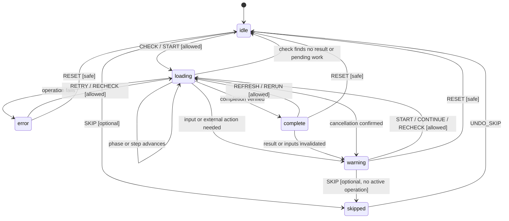

# ProtoCard state-machine plan

## Goal and scope

Use ProtoCard to prove a reusable card lifecycle before adopting it elsewhere.
The prototype must use the real shared Card component, but fake all operations:
no cloud resources, sign-in redirects, deployments, or credentials.

This document is the planning deliverable. It does not implement the machine or
change existing cards. ProtoCard.tsx currently contains only template comments.

## What the existing cards tell us

| Existing behaviour | Evidence | Consequence for the prototype |
| --- | --- | --- |
| Seven presentation statuses already exist: idle, loading, complete, warning, error, skipped, unavailable. | [types.ts](../../types.ts#L36) | Reuse the status vocabulary and theme rather than inventing new colours/statuses. |
| Locked cards still expand, show an introduction and prerequisite links, and hide interactive children. Unavailable cards retain their explanatory content; both suppress header actions. | [Card.tsx](../../components/Card.tsx#L101), [Card.tsx](../../components/Card.tsx#L240), [Card.tsx](../../components/Card.tsx#L283) | Locking, configuration availability, and expansion are not execution stages. |
| App derives locking from prerequisite hooks' `done`, not their displayed status. Unavailable takes precedence over missing prerequisites. | [App.tsx](../../App.tsx#L328) | Preserve dependency semantics independently of header presentation. |
| GitHub login reports loading; Azure login includes a separate tenant-selection requirement. The currently unmounted AWS login also has an MFA interaction. | [useGithubLoginCard.ts](../GithubLogin/useGithubLoginCard.ts#L275), [useAzureLoginCard.ts](../AzureLogin/useAzureLoginCard.ts#L82), [useAwsLoginCard.ts](../AwsLogin/useAwsLoginCard.ts#L134) | Support asynchronous checks, execution, and waiting for user input. Do not equate signed-in with fully configured. |
| Repo distinguishes cloning, branch creation, refresh, validation warnings, errors, and completion. | [useRepoCard.ts](../Repo/useRepoCard.ts#L36) | Activity labels and actionable warning reasons belong in machine context. |
| Subscription selection can be unsaved. App registration is not done until target-matching results, saved variables, and access checks agree. | [useAzureSubscriptionCard.ts](../AzureSubscription/useAzureSubscriptionCard.ts#L110), [useAzureAppRegistrationCard.ts](../AzureAppRegistration/useAzureAppRegistrationCard.ts#L310) | Successful execution does not necessarily mean complete; saving and verification are real phases. |
| Core/frontend infrastructure, domain, admin-user, and AWS SSO hooks expose running/checking/step/error state, but their headers do not consistently reflect all of it. App registration and remote-terminal infrastructure have richer activity/error projections. | [useCoreInfraCard.ts](../CoreInfra/useCoreInfraCard.ts#L367), [usePrivateFrontendInfraCard.ts](../PrivateFrontendInfra/usePrivateFrontendInfraCard.ts#L355), [useCreateDomainCard.ts](../CreateDomain/useCreateDomainCard.ts#L481), [useCreateAdminUsersCard.ts](../CreateAdminUsers/useCreateAdminUsersCard.ts#L394), [useAwsSsoCard.ts](../AwsSso/useAwsSsoCard.ts#L150), [useRemoteTerminalInfraCard.ts](../RemoteTerminalInfra/useRemoteTerminalInfraCard.ts#L520) | One lifecycle should drive the prototype's header, body, progress, and action guards. Do not copy these reporting inconsistencies. |
| Domain setup may finish creating resources but still need DNS verification and optionally promotion to primary. AWS SSO stack waits for externally created stack output. | [useCreateDomainCard.ts](../CreateDomain/useCreateDomainCard.ts#L418), [useAwsSsoStackCard.ts](../AwsSsoStack/useAwsSsoStackCard.ts#L73) | Waiting for an external action is not a failed run or a permanently spinning operation. |
| Backend/frontend deployment already share presentation helpers that prioritise errors, access, and activity over stale version comparisons. | [buildStatus.ts](../../logic/buildStatus.ts#L11), [useBackendDeployCard.ts](../BackendDeploy/useBackendDeployCard.ts#L278), [useWebDeployCard.ts](../WebDeploy/useWebDeployCard.ts#L254) | Preserve this prior art; do not introduce a competing deployment-status policy during the prototype. |
| Stage cards distinguish plan success from deployment success, changed/missing inputs, optional skipping, dispatch failures, and cancellation. An active run currently projects idle in one path. | [useCorpStageCards.ts](../Stage/useCorpStageCards.ts#L68), [stage.ts](../../logic/stage.ts#L57), [stage.ts](../../logic/stage.ts#L152) | Plan success maps to ready-to-deploy, not complete. The prototype should consistently show active work as loading; adoption would be an explicit change. |
| AVD gallery, image, and PAW cards share one deployment hook, including polling, terminal sign-in, failure, and cancellation. | [usePrivAvdDeploy.ts](../../hooks/util/usePrivAvdDeploy.ts#L44), [useRemoteTerminal.ts](../Stage/useRemoteTerminal.ts#L159) | Keep terminal connection states and workflow steps local; map their relevant events into the shared lifecycle. |
| Access pass operates per user. Global groups, currently not mounted in App, is ongoing management: `done` means loaded once, even though later operations can fail. | [useAccessPassCard.ts](../AccessPass/useAccessPassCard.ts#L296), [useGlobalGroupsCard.ts](../GlobalGroups/useGlobalGroupsCard.ts#L490) | A previous valid result, current operation outcome, and domain completion are separate facts. |
| Progress counts skipped stage cards as complete, but stage prerequisites require complete status; ordinary dependencies use `done`. | [App.tsx](../../App.tsx#L395), [stage.ts](../../logic/stage.ts#L96) | Do not globally treat skipped as satisfying dependencies. |

Review scope: the shared frame, App orchestration, current card hooks, unmounted
AWS login/Global Groups variants, and their shared lifecycle helpers. Archived
AwsSetup is not a template requirement. GitHub signup is informational and reports
completion from GitHub login; it must not be forced through a fake execution flow.

## Proposed model

Use a small, pure TypeScript reducer with React's existing `useReducer`.
No new state-machine package, global event bus, or workflow engine.

### Three independent concerns

1. **Availability:** `unavailable | locked | available`, derived from current
   configuration and unmet prerequisites, in that order. Never store both a
   writable locked boolean and a separate writable availability state.
2. **Lifecycle:** reuse `idle | loading | warning | error | complete | skipped`.
   Add typed detail only where needed to explain the activity or next action.
3. **Presentation:** `expanded | collapsed`, remaining owned by the caller.
   Toggling never starts, resets, cancels, or completes work.

Project availability and lifecycle into the existing CardChrome shape:
unavailable -> unavailable status; locked -> idle status plus locked=true and
requirements; otherwise -> lifecycle status. Derive the existing unavailable
boolean from that same result. Keep Card's rendering and keyboard behaviour.

### Lifecycle details and visible behaviour

| State/detail | Existing CardStatus | Meaning and actions |
| --- | --- | --- |
| Idle | idle | Not started or informational; explain the next action. Start only if its guards pass. |
| Checking | loading | Reading/restoring status, checking access, or validating remotely. No duplicate exclusive operation. |
| Running | loading | Executing work; show current step and progress. |
| Saving | loading | Work succeeded, but required outputs are still being saved. |
| Verifying | loading | Confirming the result meets the card's completion contract. |
| Needs input / access / consent | warning | Explain what must change. Allow relevant editing, sign-in, consent, or recheck actions, not an invalid run. |
| Awaiting external action | warning | DNS, device-code sign-in, external stack output, or another user action is required. Show the instruction and continuation/recheck action. |
| Ready for next operation | warning | For example, a plan or new build is ready to deploy. This is not completion. An ordinary first-run button can remain idle. |
| Stale / changed / cancelled | warning | Explain why recheck, replan, or retry is needed. Cancellation must not look like success. |
| Failed | error | Show the error and failed step, retain useful partial output, and offer an appropriate retry when supported. |
| Complete | complete | The card-specific completion contract is currently satisfied; results remain visible and rerun/refresh can still be available. |
| Skipped | skipped | Only an explicitly optional card may enter this state. Preserve its reason. |

Use discriminated unions for loading activities and warning reasons instead of
independent `isLoading`, `isRunning`, `isSaving`, `hasFailed`, and `isComplete`
flags. Field validation errors, SetupStep arrays, row outcomes, and terminal
connection substates remain with their existing owners.

Context holds only facts needed for behaviour: target identity, current inputs,
unmet requirements, activity/step, warning/error details, operation identity, and
any previous result. Domain-specific result types stay in the card.

### Completion is a contract, not a colour

Keep the existing card-specific `done` contract during adoption. Do not replace
it with `status === "complete"`: a previously provisioned resource can remain a
valid dependency while a later refresh/rerun fails, whereas a changed target or
invalidated resource must revoke completion.

The prototype's concrete contract is: the result belongs to the current target,
required outputs are saved, and verification succeeds. Creation alone is not
enough. Keep a last successful result for diagnostics without trusting it as
completion for another target. Preserve existing per-card progress/skip rules.

## Transitions and guards

Availability gates every operation-start/continue event; it is not shown as a
second diagram. Expansion is allowed in every state. Assessing current facts can
also produce warning, complete, or skipped without first executing a write.

| Event | Required behaviour |
| --- | --- |
| Configuration/prerequisites change | Recompute availability. Block new writes immediately. If current assumptions become invalid, invalidate local continuations and recheck when available again; retain diagnostic output. |
| START | Require available, valid required inputs, necessary access, and no active exclusive operation. Enforce in the handler as well as button disabling. |
| Phase/step update | Accept only for the current target and operation. Update one source of truth used by header and body. |
| NEEDS_ACTION / CONTINUE | Retain a paused operation's identity when continuation is real; block a second start. Otherwise expose a recheck/new operation, not a fictional resume. |
| Operation succeeds | Advance to saving/verification when required. Only the domain completion assessment can enter complete; an intermediate plan/build can instead enter ready-for-next-operation. |
| Operation fails | Enter error with actionable detail. Do not let a retained older result overwrite the current failure in the header. |
| RETRY | Distinguish retrying a read/save/verification from repeating a write. Reuse an existing successful creation result when only saving failed. |
| Inputs/target change | Reject results from the old scope. Relevant input changes revoke verification and require recheck; target changes clear current-scope completion. |
| RESTORE | Restore target-scoped result data, then check it. Never restore loading/running or assume a persisted result is still valid. No automatic write on reload. |
| RESET | Clear local prototype workflow/result state when safe. It is not deletion of provisioned resources. No reset of active work masquerading as cancellation. |
| CANCEL | Offer only when the operation supports it. Stopping observation does not prove a remote operation stopped; describe that distinction and require reconciliation before another conflicting write. |
| SKIP | Allowed only for optional work and no active operation. Neither a skipped substep nor an optional label alone makes a whole card skipped. |

Invalid user actions must produce useful feedback without executing a side
effect. Late responses from superseded operations are expected and discarded.
Aborting a local request is an optimisation; target/operation identity checks
remain the correctness guard.

**Presentation precedence:** unavailable > locked > current lifecycle.
Within an available card, current-operation activity/outcome supersedes older
success. A new accepted retry clears the previous attempt's error. Distinguish a
recoverable permission/consent action (warning) from an operation/check failure
(error). Do not let an unrelated background read hide a current write failure.

## ProtoCard test harness

Implement one real Card with a compact scenario control panel outside its body,
so locked and collapsed cases can still be exercised. Show the current
availability, lifecycle/detail, domain `done`, target, and accepted event history
as text. No extra visualisation or separate fake card renderer.

The harness should expose:

- Configuration available/unavailable and one simulated prerequisite, with a
  working requirement-navigation callback.
- Valid/invalid input and target A/B.
- Start, refresh, rerun, save retry, verify/recheck, reset, and optional skip/undo,
  visible/enabled only when meaningful.
- Deterministic completion controls for success, failure, delayed response,
  consent/user action, partial success, cancellation, and verification invalidation.
  Use deferred promises/fake timers in tests, not arbitrary sleep durations.
- A simulated result that can require saving and verification before completion.
  Permit delaying a target-A response until after target B starts.
- An optional persisted fake result using the existing storage helper, scoped to
  a separate prototype key. Never persist credentials, run-in-progress state,
  real access-pass values, or production card data.

Initially mount this harness directly in the existing Vitest browser project.
For manual use, expose it through a development-only entry in the existing app,
with a dynamic import and no production progress/dependency registration.
Add the prototype CardId only when wiring that entry; do not borrow a real card's
ID or bypass CardChrome types with casts.

## Verification and acceptance

Use the existing unit/web projects in [vitest.config.ts](../../../vitest.config.ts)
and the shared component-test mounting pattern in
[SharedBuildingBlocks.browser.test.tsx](../../test/SharedBuildingBlocks.browser.test.tsx).

Focused unit scenarios:

1. Unavailable beats missing prerequisites; restoring configuration reveals the
   lock; satisfying requirements makes operations available.
2. Happy path: idle -> running -> saving -> verifying -> complete; `done` remains
   false until the prototype's completion contract passes.
3. Guarded starts: locked, invalid input, missing access, and double-clicks perform
   zero invalid/duplicate writes. A paused continuation also prevents duplication.
4. Failure/partial success: failed creation, failed save after successful creation,
   failed verification, and failure after earlier success show the current error.
   Save retry must not repeat creation.
5. User/external action and cancellation: waiting is not complete; continuation
   or recheck works; confirmed cancellation and unknown remote outcome differ.
6. Changed inputs/targets: old responses cannot update the new scope, and stale
   success cannot satisfy it. Recheck can revoke previous completion.
7. Restore: a matching result is checked before trust; a mismatched/invalid
   result is not accepted; restoration never starts a write.
8. Skip/undo: only optional idle/warning work can skip. A skipped step does not
   skip the card or implicitly satisfy a dependency.

Browser scenarios using the actual ProtoCard and shared Card:

- Header status/summary, body feedback, progress, and enabled actions agree
  throughout the main flow and representative failure/waiting paths.
- Expand/collapse works in every availability state without changing lifecycle.
  Locked content is replaced with prerequisite guidance; unavailable explanation
  stays visible and header actions are suppressed.
- Requirement navigation works; Enter/Space toggles; focus remains usable after
  transitions; progress/status and error messages use suitable live regions.
- Check light/dark mode at 1280px and 390px, including long errors/summaries and
  no horizontal overflow. Reuse the existing accessibility checks where possible.

Acceptance: every listed lifecycle and availability state is reachable through
real events, not direct status setters; invalid transitions cause no side effects;
late results cannot corrupt current state; all focused tests, TypeScript checks,
and lint checks pass. Production cards and production progress remain unchanged.

## Implementation sequence

1. Add the pure reducer and presentation projection beside ProtoCard, plus
   focused unit tests. Keep them local until the prototype proves the contract.
2. Implement ProtoCard with fake operations and the real Card; add its browser
   tests and development-only manual entry.
3. Exercise the acceptance cases. Record any intentionally changed semantics
   before adoption, especially active-run headers and completion/skip policies.
4. Only after prototype approval, extract the proven reducer/projection into
   shared logic. Migrate one representative card at a time: Repo, a multi-step
   setup card, then stage/terminal deployment and ongoing-management variants.
   Preserve existing domain helpers and run each migrated card's existing tests.

Do not migrate all cards, rewrite deployment helpers, unify domain steps, add
automatic retries, or change persistence policies as part of the prototype.
